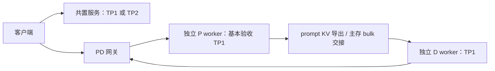

# 基于 mini-vLLM 的单机多卡大模型推理框架开发

## 定位与交付

本项目基于开源 MinivLLM 二次开发，面向实习简历与面试。目标模型为 **Qwen3-14B**，围绕已有 TP2、P/D 分离和 FP8 KV cache，完成实现审计、必要修复、正确性验证、支持范围、小规模测量和讲解材料。允许复用 vLLM、SGLang 的成熟实现，保留许可证、来源和实际贡献边界。

先分别验收 BF16 TP1、BF16 TP2、双卡 BF16 1P1D bulk、单卡 FP8 KV；组合按实际验证记录。已有 TP2 P＋两个 TP1 D、逐层传输和弹性调度代码保留，不要求这轮全做。只有简历需要写“四卡部署”时才补真实四卡结果，不要求性能提升或胜过成熟框架。完整范围见 [需求](llm_serving_project_requirements_zh.md)，执行与验收见 [任务](../.codex/tasks/m8.md)、[验收清单](../.codex/tasks/m8_acceptance.md)。

## 实现与数据流



TP2 模型按 rank 分片：Q/K/V、gate/up 与 embedding/head 按各自语义切分，Row Linear 经 all-reduce 求和；rank 0 聚合 logits、采样并下发后续执行命令。严格 loader 检查参数和 checkpoint 张量覆盖。基础 TP 层、模型及 NCCL 来自上游，本项目做加载、分片、执行协议和生命周期适配/修复，见 [M4](m4_runtime_zh.md)、[M8](m8_runtime_zh.md)。

PD 两端有独立引擎、请求状态和 block table。prompt 长 N 时，P 完成 prefill、生成并发送首 token 一次；交接的是位置 `[0,N)` 的 prompt KV。D 分配自己的物理块，恢复 KV，在位置 N 处理首输出并生成第二个输出，不重算 prompt。首 token 即 EOS、`max_tokens=1` 或达到总长度上限时直接结束，不做无用交接。TP2 P 的 bulk 扩展先经 D2H 和独立 Gloo 组汇总各 rank 的完整 KV heads，再交给 TP1 D；这与模型计算的 NCCL 组不同。

关键入口：

| 职责 | 代码与验证入口 |
|---|---|
| TP 加载、分片、通信与进程 | `src/myvllm/layers/linear.py`、`layers/embedding_head.py`、`utils/loader.py`、`engine/model_runner.py`、`engine/llm_engine.py`；`tests/test_tp_checkpoint.py`、`test_tp_gpu.py` |
| PD 元数据、KV、请求与传输 | `src/myvllm/pd/{protocol,kv,core,worker,client,gateway}.py`；`tests/test_pd_gpu.py` |
| TP2 bulk 全头汇总 | `src/myvllm/pd/tp.py`；`tests/test_pd_tp_bulk.py`、`test_pd_tp_gpu.py` |
| FP8 KV 量化与 attention | `src/myvllm/layers/attention.py`、`engine/model_runner.py`；`tests/test_fp8_storage.py`、`test_fp8_attention.py`、`test_fp8_model_gpu.py` |
| FP8 PD | `tests/test_pd_fp8_core.py`、`test_pd_fp8_gpu.py`；格式和计算模式见 [M7](m7_runtime_zh.md) |
| 诊断、配置与测量 | `tools/compare_hf.py`、`compare_runs.py`、`compare_pd.py`、`diagnose_tp.py`、`prepare_pd.py`、`run_b0.py`、`analyze_bench.py`、`analyze_pd.py` |

## FP8 的准确含义

```json
{
  "dtype": "bfloat16",
  "kv_cache_dtype": "float8_e4m3fn",
  "fp8_prefill_compute_dtype": "float32"
}
```

BF16 参考使用 `kv_cache_dtype="auto"`。权重仍是 BF16 safetensors，activation 仍为 BF16；本项目没有加载预量化 FP8 权重、实现 FP8 权重量化或使用 FP8 GEMM。

已实现的量化发生在运行时 KV 写入：每个 token 的每个 K/V head 独立计算 `scale=max(amax/448,float32_tiny)`，全零 head 使用 1；除以 scale、clamp 后写 E4M3FN。data 布局为 `[2,layers,blocks,block_size,local_kv_heads,head_dim]`，FP32 scale 去掉最后一维。Triton attention 按 block table 读取并反量化，PD 传输原始 data＋scale，不重新量化。默认 FP8 prefill 中间计算为 FP32；可选 `query` 模式借鉴 vLLM 的反量化后转 Q dtype 机制，其最终 GPU 验证与默认模式分开记录。

实际空间包含 data、scale、block 填充和运行时开销。权重字节、KV 池和设备显存分别统计，不把预分配容量当作实时用量，不把存储节省写成加速。BF16→FP8 是有损比较，同格式 P→D 才检查有效字节交接等价性；少量输入通过不支持“无精度损失”。

## 当前状态与组合支持矩阵

更新日期：2026-11-18，当前目标模型在 4×L40S 上的原始数据、修复前后对照与命令见 [实测报告](l40s_acceptance_2026-11-18_zh.md)。表中“验证通过”仅覆盖实际输入与配置；通用 logits 误差门槛和大规模质量结论尚未建立。修复前基线为 `65906d2`，历史 M2/tiny 结果不移作本轮数据。

| 能力 | Qwen3-14B / L40S 实际状态 | 限制与尚缺 |
|---|---|---|
| BF16 TP1 | 已实现且固定输入检查通过：六组各 16 输出对 HF greedy 6/6；同前缀重算 top1 为 95/96 | 最大 logits 差 5.53125；非通用数值等价或任务质量验收 |
| BF16 TP2 | 原 tiny 严格失败已修复；原 GPU FP32/BF16 两项通过，14B 六组各 16 输出对 TP1 一致、同前缀 top1 为 96/96；共置 HTTP 支持 TP2 | CUDA BF16 Row 保留 FP32 部分积/归约，通信 payload 加倍；最大 logits 差仍有 9.671875，正式 logits 容差未定 |
| BF16 PD，TP1＋TP1 bulk | 已实现且限定检查通过：六组有效 KV 字节一致，生成/分页/位置、串行/少量并发、单输出/取消回收有真实双卡验证 | 14B 数值捕获每组 4 输出，生命周期每组最多 16；没有生产故障或稳定 SLA 结论 |
| FP8 KV TP1 | 已实现且限定检查通过：六组各 16 输出与 BF16 KV 一致，logits finite，固定池 data＋scale 减少 48.4375% | 默认 FP32 prefill 很慢，不能称 FP8 加速或无精度损失；`query` 模式未补目标模型验证 |
| TP2＋PD bulk | 已实现并实际启动四卡 TP2 P＋两个 TP1 D；进程、请求交接、并发和回收运行，存在组合数值问题 | 修复后 chat-1 第 10 个输出与 TP1 不同，六组串行为 5/6；该组合计时仅作诊断，不能标完整正确性通过。没有 GPU 全头逐字节对照 |
| FP8＋TP2（共置） | 分片 KV data/scale 与 attention 路径已有，GPU 模型结果待验证 | 没有已通过的 14B FP8 TP2 证据，不列作本轮必补组合 |
| FP8＋PD，TP1＋TP1 | 本地 tiny 同卡 bulk/pipeline 有验证；不代表跨卡或当前模型完成 | 14B 独立 GPU 与最终配置；本轮只按实际补测记录 |
| FP8＋TP2＋PD bulk | 已实现并有 CPU/Gloo data＋scale 汇总/交接验证 | 真实 GPU 与 14B 未验收；不为补齐组合无限扩展 |
| TP>1 D、TP2 pipeline | 尚未支持，入口明确拒绝 | 不纳入本轮 |
| FP8 权重/activation/GEMM | 尚未支持 | 不以 FP8 KV 的结果代替 |

修复前原 TP2 tiny BF16 为 `[32,33,62]`，HF/TP1 为 `[32,33,41]`。本轮用相同输入与权重重放，完整复现第 0 层 `o_proj` 的 113/320 个差异，定位为各 shard 部分积先舍入 BF16 再求和的差别。生产修复保留 FP32 部分积与归约、最终再转 BF16，原严格用例已通过，未改变容差。修复前失败、诊断 FP32 干预和最终 BF16 输入的实现分别保存，见 [M4](m4_runtime_zh.md)。独立 TP2 的通过不能自动外推到 TP2＋PD；后者的分歧继续作为当前已知问题。

历史证据与范围：

- Qwen3-14B TP1：见 [M2 实测](m2_measurements_2026-11-14_zh.md)，原始 `alignment-14b.json`、`custom-14b.pt` 及配置位于该文档的远端数据目录；不是最终代码/L40S 结果。
- PD/FP8 tiny GPU：见 [M5](m5_runtime_zh.md)、[M7](m7_runtime_zh.md) 的已运行范围、容差与复现入口，不移作 14B 成果。
- 历史 CPU 完整回归为 995 passed、73 skipped；2026-11-17 本地 TP bulk/部署/FP8 core 专项为 21 passed。CPU/Gloo 交接测试使用模型执行替身，不能证明 CUDA/NCCL 或 14B。
- 历史四卡性能只形成 BF16 chunk 共置基线的短/长/混合各 32 个成功请求；PD 存在启动/容量失败，FP8 没有有效最终性能对照，不能计算 TP2/PD/FP8 加速比。

仓库外历史记录根目录为 `stages-20261115/evidence/m8-execution-20261116-01/`（相对仓库父目录）；TP2 见 `p3a-gpu-bf16-04-audit/`，CPU 及性能见 `offline-20261116-01/integration-main-cpu-01/full-cpu.log`、`offline-20261116-01/saved-performance-audit.json`。这些文件不随 Git 推送，新验收须另保留可交付的摘要与原始结果位置。

2026-11-17 文档整合时的完整 CPU 回归为 **995 passed、73 skipped、4 warnings，715.45 秒**，日志位于执行机 `/tmp/minivllm-project-delivery-20261117/full-cpu.log`；当次只修改文档/tasks、屏蔽 GPU，未解决历史 TP2 失败。2026-11-18 的实现修复、GPU 结果及最终 CPU 回归以本轮实测报告为准，不能用旧 CPU 数字代替。复现入口：

```bash
CUDA_VISIBLE_DEVICES='' OMP_NUM_THREADS=1 MKL_NUM_THREADS=1 \
  PYTHONPATH="$PWD/src:$PWD/tests:$PWD" \
  uv run --no-sync python -m pytest -q -p no:cacheprovider
```

## 已准备环境与开卡顺序

当前 L40S 租机的任务目录为 `/root/data/zincion/ai-infra/l40s-20261117`，模型、环境、缓存、日志和临时文件均存放在实际挂载于 `/root/data` 的 150 GiB 数据盘中。旧 `/Data2/...` 任务路径仅保留兼容链接；学校内网服务器的目录限制只适用于旧机器，详见 [租机记录](server_hardware_l40s_2026-11-17.md) 与 [学校服务器记录](server_hardware_2026-11-09.md)。2026-11-18 已在四张实际 L40S 上执行目标模型验证，当前结果以本页上表和实测报告为准。

Python 3.11.16、torch 2.9.1+cu128、Triton 3.5.1、Transformers 4.57.3 已安装。模型读取检查为 8 分片、443 个 BF16 张量、29,536,614,400 字节权重。无卡单 CPU 配额下，原 CPU 专项 14 passed/7 个启动超时；只将 TP fixture 启动通信预算改为运行时默认 30 秒的补充检查为 21 passed。补充结果不替代原 5 秒用例，也不代表 GPU 验收；证据在远端 `runs/pytest-cpu*.log`、`runs/model-ready.json`。

短请求复现入口如下；正式正确性、4K/128 测量和 profile 使用实测报告中的配置：

```bash
source /root/data/zincion/ai-infra/l40s-20261117/env.sh
cd "$PROJECT_ROOT/repo"
python -c 'import torch; print(torch.__version__, torch.version.cuda); print(torch.cuda.device_count())'
CUDA_VISIBLE_DEVICES=0 python main.py --config "$PROJECT_ROOT/configs/single-bf16.json"
CUDA_VISIBLE_DEVICES=0 python main.py --config "$PROJECT_ROOT/configs/single-fp8.json"
```

这两份配置为 eager、512 总长度、32 输出、4 序列、8 KV block，仅供短请求验证，不能用来测 4K 输入。开卡前确认服务器源码与本轮最终候选一致；复用已装环境，不盲目 `uv sync` 重新下载完整 vLLM 依赖。实际 GPU/CPU/NUMA、显存、KV 和传输预算开卡后检查，旧的 GPU0/1/3/4 映射不得直接套用。

本轮依次运行 TP1/HF、TP2 原失败与修复、双卡 BF16 bulk PD、FP8 KV、HTTP 测量及四卡组合。组合失败保留，继续交付独立成立的功能；复现仍沿用已有环境，不另租机器或改变计费。

## 测量与材料收尾

已完成 4096 输入、128 输出，并发 1/4、每档 8 请求；TP1/TP2 并发 4 另各补 32 请求。保存完成/失败/样本数、实际长度、TTFT/TPOT 的 mean/p50/p95/p99、输出和输入＋输出 token 吞吐、每卡显存与采样方法，以及已有 PD 首二间隔。14 批保存请求与 vLLM 0.15.0 原版统计函数独立复算一致，未另建大型测试系统。每行写明 GPU 数和部署，短样本分位数不作稳定尾延迟结论，不同资源不直接换算加速比。

并发 4 的 32 请求中，BF16 TP1 一卡输出吞吐 54.459 token/s、TTFT p95 2595.577 ms；BF16 TP2 双卡为 47.515 token/s、2500.137 ms。没有 TP2 正吞吐收益结论。最终固定生产修复后的完整 CPU 回归为 995 passed、74 skipped、4 warnings，697.09 秒，日志与原始结果随 [报告](l40s_acceptance_2026-11-18_zh.md) 交付。

独立短 profile 与正式计时分开，覆盖两个 TP rank，描述计算、通信/复制和等待，不为它新增优化任务。实测绝对数字、配置和原始结果见报告，不将四卡组合数值分歧或未验证 FP8 组合包装成全部通过。

材料完成条件为三条可直接复制的事实性简历描述、三分钟讲解和常见追问，内容围绕个人完成的 TP 适配/修复、KV 状态接管、FP8 KV 实现与验证。基础 TP/kernel/模型归上游；借鉴代码注明来源，未验证能力与未解问题不得包装成当前模型成果。
